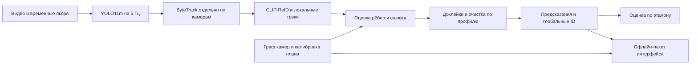
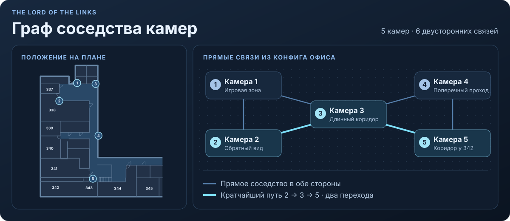

# Устройство пайплайна

The Lord of the Links превращает пять записей одного офиса в локальные треки, присваивает им глобальные ID и строит траектории на плане. Один глобальный ID описывает эпизод наблюдения. После паузы больше 60 с следующий эпизод получает отдельный ID.

Инференс идёт локально по сохранённым видео. Экспорт собирает готовый пакет с видео, треками и координатами на плане. Локальный веб-сервер открывает пакет в браузере.

## От видео до вершин графа

На каждой камере выбираем исходные кадры с частотой 5 Гц и сохраняем индекс кадра и PTS. Индекс отвечает за идентичность кадра внутри камеры. PTS используется при открытии видео. Соответствие между PTS и общим временем задают якоря записи. Сетка 5 Гц даёт шаг 0,2 с. Длина наблюдения в кадрах и разница между первой и последней отметками времени — разные величины.

YOLO11m на выбранных кадрах предсказывает рамки людей и уверенность. При включённом правиле `screens` детекция убирается до ByteTrack, если экран покрывает не менее 70% площади **самой рамки человека**. Например, маленькая рамка диктора может целиком помещаться в телевизор. Доля её площади внутри экрана тогда равна 100%, хотя IoU с большим экраном мал.

ByteTrack ведёт рамки на каждой камере отдельно с буфером 10 шагов. При 5 Гц это примерно 2 с на восстановление трека после пропуска. Вершина графа — один такой локальный трек. Она хранит камеру, упорядоченные наблюдения `(кадр, время, бокс)`, начало и конец, а также представление внешности. CLIP-ReID извлекает признаки из не более восьми кропов трека, разнесённых по времени. Для базового сходства усредняем и L2-нормируем эмбеддинги. Ранняя дедупликация может убрать повторные рамки и задать начальные группы. Фильтр формы может исключить короткий трек до построения графа.

## Рёбра и объединение групп

Кандидаты — пары локальных треков с эмбеддингами и паузой до 60 с между временными интервалами. При пересечении интервалов пауза равна нулю.

Граф камер задаёт соседство зон обзора. Для этого офиса пары задали по плану и визуальной проверке записи. Прямая связь означает, что зоны могут подхватить человека друг у друга без промежуточного ракурса. Перекрытия для геометрических проверок заданы отдельно. В [конфиге офиса](../config/site/hackathon.json) каждое направление хранится отдельно, а у всех шести пар связь задана в обе стороны. Например, у камер 2 и 5 нет прямой связи. Кратчайший путь между ними проходит через камеру 3 и занимает два перехода.

Прямое соседство и число переходов по кратчайшему пути входят в признаки LogReg. Основная сшивка рассматривает и пары треков с непрямым переходом. Для короткой доклейки `handoff` прямое соседство обязательно.

LogReg получает десять признаков.

- Косинусное сходство прототипов CLIP-ReID. В историческом коде колонка называлась `cosine_osnet` и для совместимости со старым скорером сходство CLIP преобразовывалось по таблице квантилей.
- `log1p` паузы и `log1p` длительности пересечения интервалов.
- Признаки одной камеры и прямого соседства, а также число шагов в графе камер.
- Доступность общей геометрии, согласие проекций между ракурсами и `log1p` числа пригодных пар наблюдений.
- `log1p` меньшей из медианных высот рамок двух треков.

Для геометрических признаков LogReg используются преобразования между кадрами пары камер. Ошибка между синхронными точками ног нормируется высотой бокса. Для `strict_floor` и доклеек используется другая геометрия, где точки обеих камер уже лежат на общем плане.

Скорер стандартизует признаки параметрами обучающей выборки и вычисляет `sigmoid(w · x + b)`. Когда включён `penalty`, из итогового веса сомнительного внутрикамерного ребра вычитается 0,15 с нижней границей 0. В историческом правиле смотрели до пяти наблюдений возле конца первого и начала второго трека в пределах 0,85 с. Ребро помечали, если хотя бы на одном из этих кадров расстояние между центрами своего и другого бокса, делённое на геометрическое среднее их высот, было меньше 0,85.

Группировщик начинает с одиночных вершин и принятых ранних дублей. Он рассматривает группы по убыванию среднего веса имеющихся рёбер между ними. После слияния средний вес пересчитывается. Порог основного прохода — 0,25. Если `A–B` весит 0,80, а `B–C` и `A–C` весят 0,42 и 0,06, после объединения `A` и `B` средний вес к `C` равен 0,24. В этом проходе `C` остаётся отдельно. Если ребра `A–C` вообще нет среди кандидатов, в среднее попадает только `B–C`.

Группа проходит проверку на два наблюдения с одним ID на той же камере и исходном кадре. Дополнительный `strict_floor` создаёт запреты на слияние для пар, которые устойчиво видны далеко друг от друга в одни и те же моменты. Специальные доклейки могут сначала убрать доказанный дубль или отражение и затем повторить проверку. Сцепление через несколько камер сохраняет один ID для длинного прохода. Итоговое ограничение на разрыв применяется к хронологии наблюдений группы, так что у длинного прохода могут быть короткие паузы между камерами.

## Пятнадцать правил

Файл профиля задаёт его имя и список включённых правил. Базовый пайплайн и порядок этапов общие для всех профилей. Например, фильтр экрана меняет вход ByteTrack и поэтому может изменить локальные ID, эмбеддинги и кандидатов последующих этапов.

| Этап | Правило | Что делает |
| --- | --- | --- |
| Перед ByteTrack | `screens` | Убирает детекцию внутри автоматически найденного экрана при покрытии рамки от 70%. |
| Перед графом | `early_dedup` | Убирает дубли на одних и тех же кадрах при согласии положения и внешности и задаёт начальные группы. |
| Перед графом | `shape` | Убирает трек до 2 с с двумя и более рамками, если среднее `w/h > 0,60` или стандартное отклонение `w/h > 0,15`. |
| Основная сшивка | `penalty` | Вычитает 0,15 из веса сомнительной пары внутри камеры. |
| Основная сшивка | `strict_floor` | Запрещает объединять пары с устойчиво далёкими синхронными точками. В проверенном профиле нужны ≥7 пар, медиана расстояния ≥100 единиц плана и отсутствие близких совпадений. |
| Доклейки | `far_veto` | Дополнительный запрет для части доклеек при ≥5 синхронных парах, медиане ≥54 и минимальном расстоянии ≥30 единиц плана. |
| Доклейки | `bridge` | Соединяет короткий разрыв на одной камере по движению на концах, внешности и взаимному выбору. |
| Доклейки | `boundary_dedup` | При конфликте на одном граничном кадре проверяет вложенность рамок и внешность, оставляет более уверенную рамку и объединяет группы. |
| Доклейки | `late_overlap` | Соединяет группы разных камер, если внешность и несколько синхронных точек на плане согласуются. |
| Доклейки | `reflection` | Убирает конфликтующие отражения на отдельных кадрах, если это позволяет соединить совместимые группы. |
| Доклейки | `handoff` | Ищет взаимно лучшую связь между соседними камерами через паузу до 2,5 с. Нужны косинус ≥0,88 и вес ребра ≥0,42. Меньшая группа занимает не более 25 шагов сетки 5 Гц. |
| Финальная очистка | `semantic_zones` | Убирает группу, если все её рамки устойчиво лежат в зонах экранов, зеркал или мебели. Для мебели требуются неподвижность и одна камера. |
| Финальная очистка | `static` | Ищет почти одинаковые неподвижные рамки однокамерных групп, возникшие с интервалом от 45 с. |
| Финальная очистка | `mirror_votes` | Убирает однокамерную группу, если каждую её рамку покрывают предложения зеркала из как минимум четырёх снимков сцены. |
| Финальная очистка | `short_group` | Оставляет группы с ≥8 занятыми шагами. При 2–7 шагах оставляет группу, если медиана максимальных confidence по шагам ≥0,70. |

В `shape` ширина и высота измеряются для каждой рамки. Пропорции 0,34, 0,35 и 0,37 стабильны. Пропорции 0,30, 0,76 и 0,35 дают большой разброс и могут означать, что в одном кадре детектор обвёл сразу двух людей. Сидящий человек или обрезка дверью тоже меняют форму. В испытаниях сравнивали `shape` с другим правилом, которое ищет устойчивый нахлёст короткого трека с одним и тем же длинным треком. Пять профилей здесь используют `shape` в тех местах, где он включён.

Для `short_group` несколько камер на одной отметке общей сетки дают один занятый шаг. Если камера 1 видит трек с confidence 0,80, а камера 2 в тот же момент — 0,65, уверенность шага равна 0,80. Фильтр применяется после доклеек. Когда группа отбрасывается, вместе с ID уходят её рамки.

## План офиса и перенос

Для проекции используем середину нижнего края бокса, `[(x_min + x_max) / 2, y_max, 1]`. Умножаем её на гомографию камеры `H` и делим первые две координаты на третью. Для неуверенных проекций проверяем область видимости и зоны, где ноги часто закрыты. Бокс может остаться на видео, даже если точку на плане построить нельзя. Расстояния в текущем плане измеряются в координатах SVG.

В историческом конфиге камеры 1, 3 и 4 опираются на видимые неподвижные ориентиры. Для камер 2 и 5 использовали соответствия проекций ног из синхронных наблюдений при подборе матриц. В отдельных стыках также есть фиксированные локальные поправки. Во время прогона используются уже рассчитанные преобразования. Эталонные ID и список кадров, где нужно разрезать трек, на вход модели не подаются.

Для нового офиса понадобятся план, граф переходов между камерами, временные якоря и калибровка ракурсов. Для каждой камеры можно собрать пары «точка на кадре → та же точка на плане» по порогам, углам и другим неподвижным точкам на полу. Требуются хотя бы четыре неколлинеарные пары. Практически важны ориентиры, распределённые по рабочей зоне, и проверка на отдельных точках. При неподвижных камерах матрицы переиспользуются для новых записей, временные якоря готовятся для каждой записи. Если отличаются геометрия, ракурсы или условия съёмки, пороги геометрии и параметры LogReg проверяются на размеченных переходах нового офиса.

Если несколько камер дают близкие координаты для одного ID, используем медиану координат. При сильном расхождении выбираем проекцию с самой высокой рамкой среди пригодных. Сглаживание применяется при отображении карты. В локальном непрерывном фрагменте берём взвешенное среднее `p̂(t) = Σ wᵢ pᵢ / Σ wᵢ`, где `wᵢ = exp(−(tᵢ − t)² / (2σ²))` и `σ = 0,32 с`. Координаты для оценки рёбер и ID считаются до этого шага.

[Профили и эксперименты](EXPERIMENTS.md) · [Контракт интерфейса](DATA_CONTRACT.md) · [Ограничения](LIMITATIONS.md)
